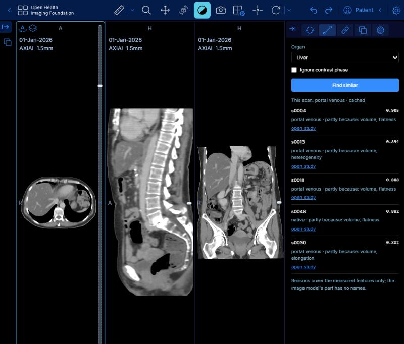
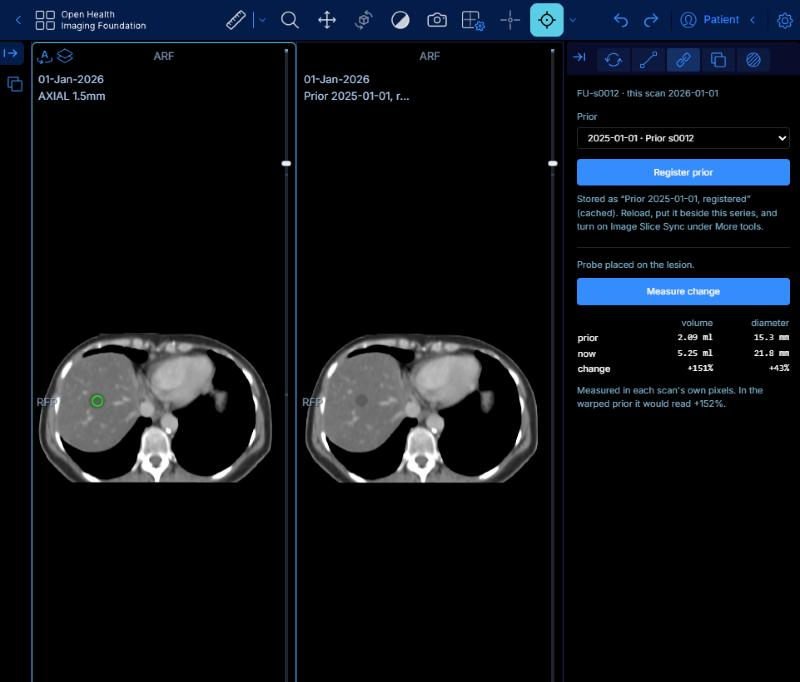
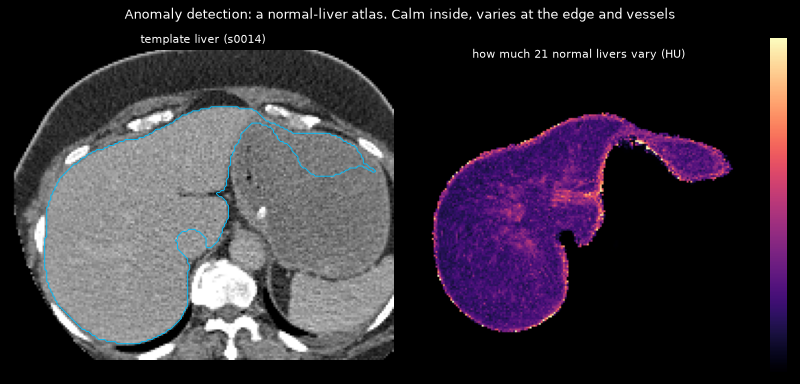

# Argus

A CT viewer with an AI layer, for research. Runs locally: no telemetry, nothing
leaves the machine. Not a medical device.

Built on OHIF and Cornerstone3D, with Orthanc as the PACS and a Python service
for the models.

## What it does

- **Segmentation**: threshold or TotalSegmentator, stored back as DICOM SEG.
- **Jobs**: long runs go through a queue, with progress, cancel and a cache.
- **Similar cases**: pick an organ, get the most similar ones from other
  patients and why they match, open any of them.
- **Compare with prior**: register an older scan onto the current one so they
  scroll together, then measure how a lesion changed.
- **Anomaly detection** (research): find planted liver lesions three ways and
  compare them honestly.







## Results

**Similar cases.** A query is described exactly like the index: a case
described from its own files matches itself digit for digit. With a predicted
mask it still finds itself first, at 0.96-0.99 against ~0.91 for the next.

**Compare with prior**, on a made follow-up (moved, warped, lesion grown +152%):

| | error |
|---|---|
| no registration | 20.1 mm |
| rigid | 1.19 mm |
| rigid + B-spline | **1.05 mm** |
| lesion change measured | **+151 to +155%** (true +152%) |

**Anomaly detection**, liver, 13 test scans with 13 planted lesions, tuned for
about 1 false alarm per scan:

| method | lesions found | false alarms / scan |
|---|---|---|
| threshold against the patient's own liver | **31%** | 1.2 |
| threshold against an average liver | 0% | 15 |
| atlas of 21 normal livers | 38% | 116 |

The simple per-patient threshold held up. Livers differ from each other more
than a lesion differs from its own liver, and one noisy scan sinks the atlas.

## Run it

Docker Desktop running, then:

```bash
docker compose up -d
```

```bash
python -m venv .venv
```

```bash
./.venv/Scripts/python.exe -m pip install -r services/ai/requirements.txt
```

OHIF is a pinned, gitignored checkout (v3.13.10, Node >= 24, pnpm 11):

```bash
git clone --depth 1 --branch v3.13.10 https://github.com/OHIF/Viewers.git viewer/Viewers
```

```bash
./.venv/Scripts/python.exe scripts/link_viewer.py
```

```bash
./.venv/Scripts/python.exe scripts/dev_viewer.py
```

AI service, in another terminal:

```bash
./.venv/Scripts/python.exe -m uvicorn app.main:app --port 8000 --app-dir services/ai
```

Viewer at <http://localhost:3000>, Orthanc at <http://localhost:8042>.

Tests:

```bash
./.venv/Scripts/python.exe -m pytest services/ai
```

## Known gaps

- Follow-ups and anomaly lesions are synthetic; no real longitudinal pairs yet.
- Anomaly detection covers the liver, portal venous phase only.
- Everything runs on CPU here; TotalSegmentator takes ~2 minutes a scan.
- A registered prior needs a reload and a manual 1x2 layout to show.
- Interactive segmentation waits on a GPU with ~10 GB.
- Orthanc has auth and CORS off and is bound to localhost only. Unbind it and
  auth goes back on in the same change.
